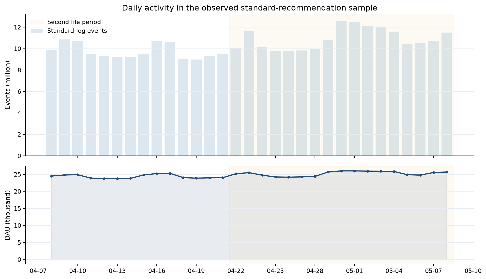
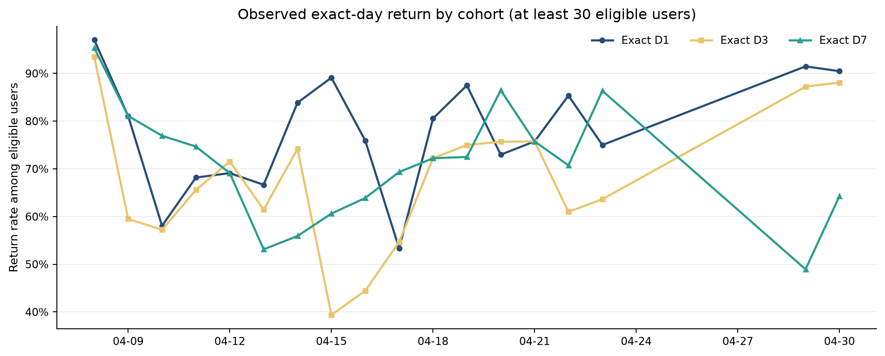
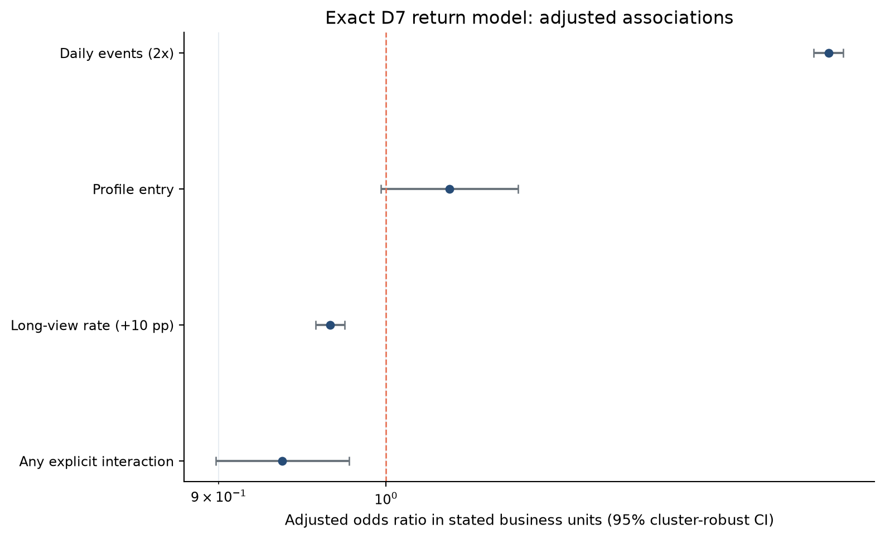

# KuaiRand-27K 用户活跃、参与、回访与内容分析

> 分析 KuaiRand-27K 固定用户面板在 31 天内的活跃、参与、窗口内再次活跃和内容表现。数据治理与统计流程使用 DuckDB、SQL、Parquet 和 Python。

[最终报告](reports/final_report.md) · [数据字典](docs/data_dictionary.md) · [指标字典](docs/metric_dictionary.md) · [方法说明](docs/methodology.md)

## 一、研究背景

KuaiRand-27K 提供 27,285 名固定用户的标准推荐日志、随机曝光日志和用户、视频维表。本项目从 10 个原始 CSV 出发，先完成全量质量检查和标准化，再计算活跃、参与、首次观测 Cohort 和内容表现。用户日模型使用当天变量描述随后第 7 天的活跃关联。

分析对象是固定用户面板。现有日志没有可靠的新注册流水，报告以窗口内再次出现活动描述回访，不计算平台新增用户留存。

数据由 [KuaiRand 官方仓库](https://github.com/chongminggao/KuaiRand) 发布。原始数据受发布方许可约束，本仓库不随代码分发 CSV、Parquet 或 DuckDB 数据副本。

## 二、项目概览

| 项目维度 | 全量运行结果 |
|---|---:|
| 观察窗口 | 2022-04-08 至 2022-05-08 |
| 原始 CSV | 10 个文件，45.64 GiB |
| 有效标准推荐日志 | 322,278,383 条事件 |
| 固定用户样本 | 27,285 名用户 |
| 随机曝光描述样本 | 1,186,059 条事件 |
| 视频基础/统计维表 | 32,038,725 个视频 |
| 标准化 Parquet | 10.09 GiB |
| 回访模型样本 | 591,088 个用户日 |
| 技术栈 | DuckDB · SQL · Parquet · pandas · NumPy · SciPy · statsmodels · Matplotlib · pytest |

四个业务问题分别是用户活跃与事件集中度、标准推荐曝光下的参与结构、首次观测活跃日后的 D1/D7 再次活跃，以及视频类型、时长和标签的曝光与参与差异。另用用户日 Logistic 模型检验参与变量与后续 D7 活跃的条件关联。

## 三、技术路线与口径

```text
10 个只读 CSV → DuckDB 全量质量检查 → 标准化 Parquet
→ 用户日、Cohort 和视频 Marts → SQL 结果 + Python 统计
→ 图表、最终报告与自动化验证
```

标准推荐日志用于主分析，随机曝光日志独立描述，不参与 DAU、趋势和观察回访。全量运行识别 10/10 个源文件，完成行数、字段、非法值、连接覆盖和来源隔离检查；2 条负观看时长记录被排除，业务 Marts 保留 322,278,383 条有效标准事件。日期口径使用源端 `date + hourmin`，并以 UTC+8 时间戳日期做敏感性检查。

DAU 按每天不同用户数计算；参与率以有效曝光事件为共同分母；观看深度只在正视频时长上计算；精确 D1/D7 只纳入目标日已观察的用户。模型使用当天曝光量、长观看率、任一显性互动和主页进入，按日期切分训练与验证，标准误按用户聚类。完整定义见[指标字典](docs/metric_dictionary.md)和[方法说明](docs/methodology.md)。

## 四、文件架构

```text
kuairand-user-growth-analysis/
├── README.md                 项目总览、主要结果与复现入口
├── AGENTS.md                 数据处理、指标、统计与发布约束
├── LICENSE                   MIT 代码许可证
├── pyproject.toml            Python 依赖与测试配置
├── config.yaml               数据路径、DuckDB 资源和分析参数
├── data/
│   └── README.md             原始数据获取、放置与非提交说明
├── docs/
│   ├── data_dictionary.md    源字段、标准字段、Marts 粒度与关联键
│   ├── metric_dictionary.md  活跃、参与、回访、内容和模型口径
│   └── methodology.md        数据治理、统计方法、假设认证与解释边界
├── sql/
│   ├── 01_quality.sql        全量字段、异常、重复键和连接覆盖检查
│   ├── 02_prepare.sql        日志与维表标准化及 Parquet 写出
│   ├── 03_marts.sql          用户日、日活、Cohort、模型和视频 Marts
│   ├── 04_activity.sql       日活、事件趋势、时段与用户分层
│   ├── 05_engagement.sql     整体、场景和随机曝光参与指标
│   ├── 06_retention.sql      精确回访、右截断和边界口径
│   ├── 07_content.sql        类型、时长、标签和视频统计结果
│   └── 08_validation.sql     行数守恒、来源隔离、日期敏感性和模型检查
├── src/kuairand_analysis/
│   ├── __init__.py           包初始化
│   ├── config.py             配置读取、路径与源文件校验
│   ├── db.py                 DuckDB 连接、SQL 模板和 Parquet 工具
│   ├── pipeline.py           SQL 阶段编排与重入执行
│   ├── statistics.py         聚类稳健 Logistic、区间和模型诊断
│   ├── reporting.py          结果表编排、README 与最终报告生成
│   └── visualization.py      正式图表与输出管理
├── scripts/
│   ├── run_pipeline.py       全量分析与统计模型入口
│   └── build_report.py       图表、报告和 README 生成入口
├── tests/
│   ├── test_quality.py       配置、SQL 工具和输入完整性
│   ├── test_metrics.py       回访边界、模型变量和行为汇总
│   └── test_pipeline.py      合成数据端到端流程、对账和幂等性
└── reports/
    ├── final_report.md       完整研究结果、认证、解释和局限
    └── figures/              最终报告实际引用的 7 张图
```

源数据、Parquet、DuckDB、缓存和临时输出位于本地派生目录，由 `.gitignore` 排除。`src/kuairand_analysis/reporting.py` 负责结果表编排，是报告生成所需的模块。

## 五、主要结论

### 5.1 事件量集中在少数用户

固定样本包含 27,285 名用户和 31 个观察日，日均 DAU 为 24,830。DAU 最高的日期是 2022-05-01；事件量最高的日期是 2022-04-30，当日 12,573,230 条事件。

事件量最高的四分位用户占全部用户 25.00%，贡献 56.57% 的标准日志事件。Q4 定义了样本内的高事件量组，不代表平台总体中的“高价值用户”。

### 5.2 长观看较常见，显性互动稀疏

按有效曝光计，长观看标记率为 26.04%，点赞率为 1.67%，评论率为 0.25%。观看深度 P90 为 1.101，16.29% 的合格记录高于 1；该比率不作为完播率解释。事件量峰值出现在源端 21 时。

### 5.3 两种 Cohort 口径描述不同人群

全部合格首次观测 Cohort 的精确 D1 活跃率为 94.98%，精确 D7 为 93.24%。排除观察起点 Cohort 后，D7 为 74.15%。

首日有 24,504 名用户首次出现，占面板用户的 89.81%。改用 UTC+8 时间戳日期重算后，全样本 D7 为 93.11%，与源端日期口径接近；排除首日的 D7 则为 92.71%。边界口径对日期定义高度敏感，因此两种数值都不命名为新用户留存。

### 5.4 内容分组高度不平衡

`NORMAL` 视频覆盖 320,545,303 次标准日志曝光，占全部有效事件的 99.46%，长观看标记率为 26.05%。曝光量最高的有定义时长段为 `00-15s`，该段长观看标记率为 30.92%。

标签按逗号展开后保留原始数值 ID，最高曝光标签为 `39`。这些分组差异同时包含推荐分配、受众、作者和视频属性，适合用于后续分层，不构成内容属性效果。

### 5.5 D7 模型描述样本内条件关联

日曝光量翻倍对应精确 D7 活跃的调整 OR 为 1.321（95% CI 1.309 至 1.333）。有任一显性互动相对无互动的调整 OR 为 0.937，进入主页相对未进入的调整 OR 为 1.041。

未调整时，有任一显性互动的 D7 活跃率为 96.07%，无互动为 94.44%；调整其他使用强度变量后，OR 为 0.937。原始比较与调整结果的差异表明互动组与非互动组在使用强度上并不可比。

长观看率增加 10 个百分点时，D7 OR 为 0.965；该变量在 D1 和任意 7 日结局下没有得到一致方向。验证 AUC 为 0.586，Brier skill score 为 -0.0011。模型没有提供优于常数基准的概率预测，系数仅用于样本内关联诊断。

### 5.6 建议与验证

1. 看板可以把事件总量、DAU 和单次曝光参与率并列，并按用户事件量四分位拆分。Q4 的用户贡献 56.57% 的事件，长观看标记率为 18.65%；Q1 的长观看标记率为 45.04%。
2. 用户日曝光四分位从 Q1 到 Q4 时，原始 D7 活跃率由 91.49% 升至 97.58%，平均长观看标记率由 43.65% 降至 23.33%。周报可以同时跟踪这两项指标；能否通过调整曝光量提高回访，需要另行实验。
3. 事件量在 21 时达到峰值，长观看标记率在 7 时最高，点赞标记率在 1 时最高。这些时点可以作为分目标实验假设，执行时需固定用户和内容范围。
4. 高曝光标签中，`3` 的长观看标记率较高，`67` 的点赞标记率较高。标签补充业务语义并完成多变量分层后，再用于选题评审。
5. 要监测新用户留存，需要接入首次注册或首次激活事件，并保证每个 Cohort 拥有完整后续窗口。当前面板只能提供窗口内观察回访。
6. D7 模型的验证 Brier skill score 为 -0.0011，不进入线上预测。围绕内容类型、时段、主页进入或曝光量的下一步，应先定义主指标和对照，再做随机实验。

## 六、图表预览

### 日活与标准日志事件趋势



### 首次观测活跃日后的精确日回访



### 精确 D7 回访模型的调整关联



完整图表包括时段分布、场景参与、用户分层、视频时长和 Cohort 曲线，均在 [最终报告](reports/final_report.md) 中被实际引用。

## 七、复现

### 7.1 数据准备

将以下 10 个 KuaiRand-27K CSV 放入 `data/raw/`：

- 4 份 `log_standard_*_27k_*.csv`
- 1 份 `log_random_4_22_to_5_08_27k.csv`
- 1 份 `user_features_27k.csv`
- 1 份 `video_features_basic_27k.csv`
- 3 份 `video_features_statistic_27k_part*.csv`

也可以将原始数据放在仓库外，通过 `--raw-dir` 避免重复占用磁盘。完整文件说明见 [data/README.md](data/README.md)。

### 7.2 安装环境

项目要求 Python 3.11 及以上，并在 Python 3.12 与 DuckDB 2.0 环境完成全量验证。依赖版本由 [pyproject.toml](pyproject.toml) 管理。

```bash
python -m venv .venv
source .venv/bin/activate
python -m pip install --upgrade pip
python -m pip install -e ".[dev]"
```

Windows PowerShell 使用 `./.venv/Scripts/Activate.ps1` 激活环境。使用 conda 时，创建任意 Python 3.11+ 环境并执行相同的 `pip install -e ".[dev]"`。数据路径、线程、内存和临时目录由 [config.yaml](config.yaml) 配置。

### 7.3 执行命令

```bash
python scripts/run_pipeline.py
python scripts/build_report.py
python -m pytest
```

原始数据位于仓库外时，在 `run_pipeline.py` 后添加 `--raw-dir /path/to/KuaiRand-27K/data`。

已验证的全量流水线包含 8 个阶段，在本次验证环境约 5 分钟完成。数据阶段会生成标准化 Parquet、业务 Marts、结果表、7 张图和最终报告。

## 八、验收与质量

| 验收项 | 结果 |
|---|---:|
| 源文件识别 | 10 / 10 |
| 全量对账、来源隔离和维表唯一性 | 25 / 25 |
| 自动化测试 | 全部通过 |
| 报告引用图表 | 7 / 7 |
| Markdown 相对链接 | 全部有效 |
| 核心假设与证据登记 | [方法说明第 12 节](docs/methodology.md#assumption-certification) |
| 随机数据混入主活跃/回访指标 | 无 |
| Git 中原始或派生大文件 | 无 |

## 九、研究边界

- 样本边界：固定 27K 用户和 31 天窗口只描述 KuaiRand-27K 面板，不外推为平台总体或长期增长趋势。
- 回访边界：首次观测日不是注册日；首日存量用户和较晚首次出现用户的构成差异会改变 D1/D7。
- 场景边界：`tab` 保留原始编号；`is_click` 在单列 UI 表示有效播放、在双列 UI 表示点击，点击率只在同场景内比较。
- 内容边界：视频曝光由推荐策略分配，高曝光不等于高质量；标签和 one-hot 特征没有公开业务语义。
- 统计边界：同一用户贡献多个用户日，模型用聚类标准误处理相关性。D7 验证 Brier skill score 为负，模型只用于解释样本内结果。
- 时间边界：2,359,097 条记录的源端日期与 UTC+8 时间戳日期相差一天，项目统一采用源端 `date + hourmin`。
- 许可边界：仓库 MIT License 只覆盖代码与文档；第三方数据的使用遵循 KuaiRand 发布方条款。

## 十、建议阅读顺序

1. 阅读 [最终报告](reports/final_report.md)，了解完整研究问题、全量结果、统计验证和业务解释。
2. 阅读 [数据字典](docs/data_dictionary.md)、[指标字典](docs/metric_dictionary.md) 和 [方法说明](docs/methodology.md)，核对字段、公式与时间边界。
3. 按 `sql/01_quality.sql` 至 `sql/08_validation.sql` 查看数据处理、业务建模和对账过程。
4. 阅读 `src/kuairand_analysis/`，了解配置、流水线、统计模型、报告编排和图表生成。
5. 最后查看 `tests/`，确认回访边界、非法值过滤、来源隔离和重复运行幂等性。

## 十一、许可证

本仓库代码和文档采用 [MIT License](LICENSE)。KuaiRand 数据受其原始发布方许可管理，本仓库许可证不覆盖第三方数据。
