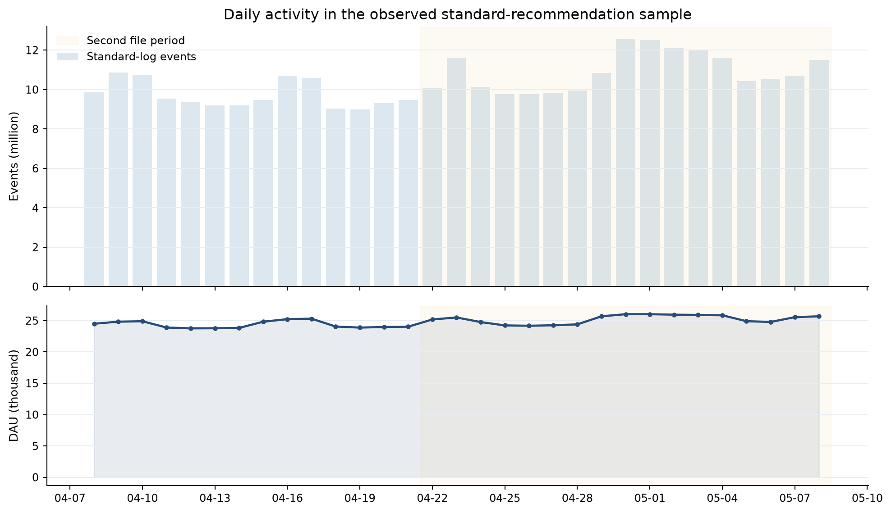
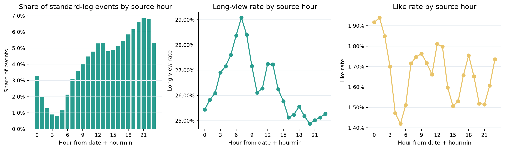
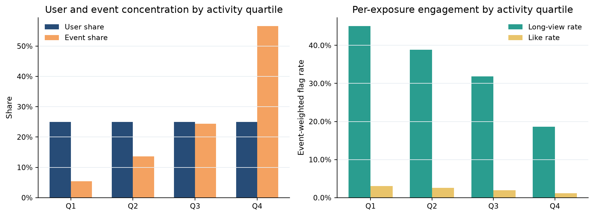
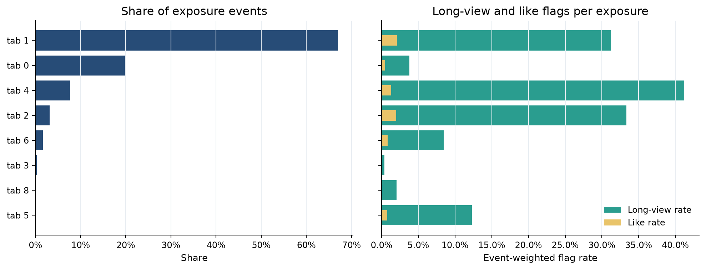
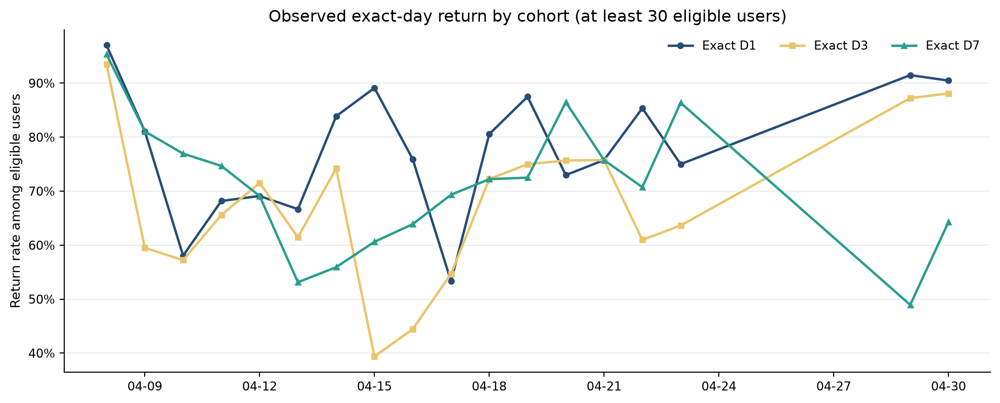
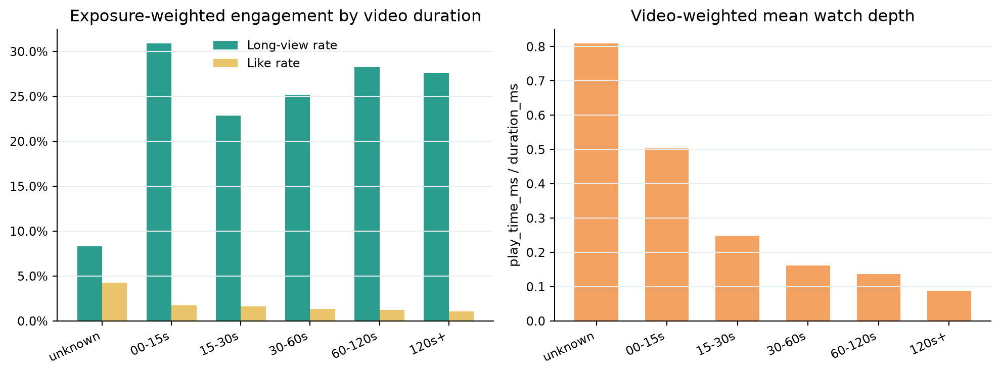
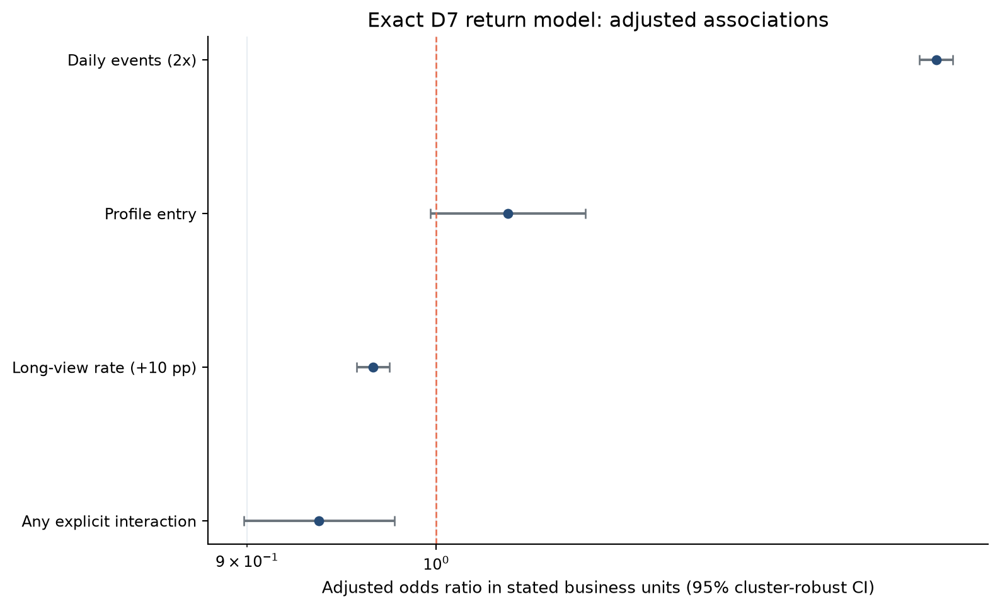

# KuaiRand-27K 用户活跃、参与、回访与内容表现分析

> 观察窗口：2022-04-08 至 2022-05-08。
>
> 主样本：322,278,383 条有效标准推荐日志事件；随机曝光日志独立描述，不参与主活跃、趋势或回访计算。
>
> 报告生成日期：2026-11-20。全部数值由仓库内 SQL 与 Python 流水线从真实原始 CSV 生成。

## 1. 研究问题与结论摘要

本研究回答五个问题：固定用户面板在观察窗口内的活跃和事件集中度如何；标准推荐曝光中的参与行为呈现什么结构；按首次观测活跃日分组后，精确 D1/D7 的窗口内再次活跃率是多少；视频类型、时长和标签对应怎样的曝光与参与结构；用户日行为与后续精确 D7 活跃有何样本内条件关联。

核心结果如下：

1. 有效标准日志覆盖 27,285 名固定面板用户和 31 个日历日，日均 DAU 为 24,830。DAU 最高的日期是 2022-05-01，当日 DAU 为 26,026；事件量最高的日期是 2022-04-30，当日事件数为 12,573,230。
2. 按曝光计，标准日志的长观看标记率为 26.04%，点赞率为 1.67%，评论率为 0.25%。
3. 全部合格首次观测 Cohort 的精确 D1 活跃率为 94.98%，精确 D7 为 93.24%。首日 Cohort 有 24,504 名用户，占面板的 89.81%；排除该边界 Cohort 后，D7 为 74.15%。这两个数描述不同样本构成下的窗口内再次活跃率，都不估计新用户留存。
4. `NORMAL` 视频覆盖 320,545,303 次标准日志曝光，占全部有效事件的 99.46%，其长观看标记率为 26.05%。视频类型分组因此高度不平衡。曝光量最高的有定义时长段是 `00-15s`，该段长观看标记率为 30.92%。
5. 在控制星期、时间趋势和其余模型中变量后，日曝光量翻倍对应精确 D7 活跃的调整优势比为 1.321（95% CI 1.309 至 1.333）。有任一显性互动相对无互动的 D7 OR 为 0.937。验证结局率接近 95%，且模型 Brier skill score 为 -0.0011，这些系数只描述样本内条件关联。

## 2. 数据、处理与质量

### 2.1 数据规模与来源边界

10 个原始 CSV 共 45.64 GiB；标准化并 ZSTD 压缩后的 Parquet 共 10.09 GiB。原始 CSV 仅作只读输入，发布仓库不包含原始数据或派生 Parquet。标准推荐日志与 `log_random_*` 随机曝光日志分别标准化并保留 `source_type`、`source_file` 和原始 `is_rand`。

| 数据类型 | 源文件 | 行数 |
| --- | --- | --- |
| random_logs | log_random_4_22_to_5_08_27k.csv | 1,186,059 |
| standard_logs | log_standard_4_08_to_4_21_27k_part1.csv | 68,148,288 |
| standard_logs | log_standard_4_08_to_4_21_27k_part2.csv | 68,148,288 |
| standard_logs | log_standard_4_22_to_5_08_27k_part1.csv | 93,062,020 |
| standard_logs | log_standard_4_22_to_5_08_27k_part2.csv | 92,919,789 |
| user_features | user_features_27k.csv | 27,285 |
| video_basic | video_features_basic_27k.csv | 32,038,725 |
| video_statistics | video_features_statistic_27k_part1.csv | 10,679,575 |
| video_statistics | video_features_statistic_27k_part2.csv | 10,679,575 |
| video_statistics | video_features_statistic_27k_part3.csv | 10,679,575 |

### 2.2 关键质量结论

| 检查 | 结果 | 口径 |
| --- | --- | --- |
| 标准日志行数 | 322,278,385 | 有效 322,278,383 行 |
| 随机曝光行数 | 1,186,059 | 有效 1,186,059 行 |
| 标准日志 ID 空值 | 0 | 分别检查 user_id 与 video_id |
| 非法二元标记行 | 0 | 按所有二元反馈字段联合检查 |
| 日期与毫秒时间戳日期不一致 | 2,359,097 | 源端日较 UTC+8 时间戳日期晚一天，保留源端日期 |
| 负观看时长 | 2 | 负值事件标记为无效，不进入业务 Marts |
| 视频时长为 0 | 27,274,006 | 保留曝光与二元反馈，不进入观看深度分母 |
| tab 超出官方 0 至 14 范围 | 0 | 异常事件不进入业务 Marts |
| hourmin 超出合法编码范围 | 0 | 异常事件不进入业务 Marts |
| play_time_ms > duration_ms | 48,052,327 | 保留；超出完整播放时长的原因需另行核验 |

事件键 `(user_id, video_id, time_ms)` 的候选重复已全量扫描。用户多次接触同一视频属于合法序列行为，事件保留原始粒度；`(user_id, video_id)` 不作为唯一键。

| 来源 | 候选重复键组 | 涉及行数 | 占该来源行数 |
| --- | --- | --- | --- |
| random | 10 | 20 | 0.00% |
| standard | 2,878,498 | 5,774,609 | 1.79% |

跨表 ID 覆盖如下。当前用户、视频基础特征和视频统计特征的相关连接覆盖率均为 100%。

| 连接 | 去重 ID 数 | 匹配 ID 数 | 覆盖率 |
| --- | --- | --- | --- |
| random_users_to_user_features | 27,285 | 27,285 | 100.00% |
| standard_users_to_user_features | 27,285 | 27,285 | 100.00% |
| standard_videos_to_video_basic | 32,038,693 | 32,038,693 | 100.00% |
| random_videos_to_video_basic | 7,583 | 7,583 | 100.00% |
| standard_videos_to_video_statistics | 32,038,693 | 32,038,693 | 100.00% |
| random_videos_to_video_statistics | 7,583 | 7,583 | 100.00% |

`date` 与 `hourmin` 共同定义源端交互日与小时；`time_ms` 用于溯源、排序和一致性诊断。全量比较发现 2,359,097 条记录的 `date` 比 UTC+8 时间戳日期晚一天，集中在时间戳 21 至 23 时附近，占标准日志 0.73%。这些记录的 `date + hourmin` 内部一致，报告采用源端交互时间。

`play_time_ms = 0` 保留为“未记录有效观看时长”；2 条负观看时长记录被标记为无效并从业务 Marts 排除。27,274,006 条事件的 `duration_ms = 0`，仍参与曝光和二元反馈统计，但不进入观看深度分母。`play_time_ms > duration_ms` 的记录保留在原值口径中；现有字段无法区分重复播放、循环播放或计量差异，报告不据此判断记录真假。全量发布对账通过 25/25 项。

### 2.3 日期口径认证

主分析采用发布方提供的 `date` 定义事件日，并以 `hourmin` 提取小时。为检验这一选择，项目另用 `time_ms` 转换到 UTC+8 后的日期重建用户日，并重算精确 D1/D7。

| 日期口径 | 偏移 | 全样本合格/活跃 | 全样本活跃率 | 排除首日合格/活跃 | 排除首日活跃率 |
| --- | --- | --- | --- | --- | --- |
| 源端 date + hourmin | D1 | 27,282 / 25,912 | 94.98% | 2,778 / 2,137 | 76.93% |
| 源端 date + hourmin | D7 | 27,196 / 25,357 | 93.24% | 2,692 / 1,996 | 74.15% |
| UTC+8 time_ms 日期 | D1 | 27,282 / 25,936 | 95.07% | 23,736 / 22,407 | 94.40% |
| UTC+8 time_ms 日期 | D7 | 27,196 / 25,321 | 93.11% | 23,650 / 21,925 | 92.71% |

源端日期口径的全样本 D7 活跃率为 93.24%，UTC+8 时间戳日期口径为 93.11%，两者相差不超过 0.2 个百分点，主要描述结论保持不变。排除首日的 D7 则从 74.15% 变为 92.71%；日期口径改变后，“首日”所包含的用户组也发生变化。该结果认证了全样本 D7 的稳定性，也说明排除首日的结果依赖观察边界，不能作为新用户留存估计。

## 3. 用户活跃



观察窗口内平均每个日历日有 10,396,077 条有效标准日志事件，日均事件数为 417.91 条/DAU。工作日与周末的观察日均 DAU 分别为 24,567 与 25,382。

| 日期 | DAU | 事件数 | 事件/DAU | 首次观测活跃用户 |
| --- | --- | --- | --- | --- |
| 2022-04-30 | 26,024 | 12,573,230 | 483.14 | 42 |
| 2022-05-01 | 26,026 | 12,514,718 | 480.85 | 22 |
| 2022-05-02 | 25,947 | 12,096,604 | 466.20 | 27 |
| 2022-05-03 | 25,904 | 11,999,564 | 463.23 | 19 |
| 2022-04-23 | 25,503 | 11,621,565 | 455.69 | 44 |



源端 `date + hourmin` 定义的事件量峰值出现在 21 时，占全部标准日志事件的 6.86%。长观看标记率峰值出现在 7 时（29.08%），点赞标记率峰值出现在 1 时（1.94%）。事件量、长观看标记率和点赞标记率的峰值分别对应不同的时段切片。

### 3.1 活跃程度分层

用户按观察窗口内事件量升序分为 Q1 至 Q4 四个等人数分位组，活跃天数和用户 ID 用于打破并列。Q4 表示事件量最高的四分之一，分组门槛和占比直接取自结果表。



| 分层 | 用户数 | 用户占比 | 最少事件数 | 最多事件数 | 最少活跃日 | 最多活跃日 | 事件占比 | 人均事件数 |
| --- | --- | --- | --- | --- | --- | --- | --- | --- |
| Q1 | 6,822 | 25.00% | 100 | 4,476 | 1 | 31 | 5.39% | 2,545.9 |
| Q2 | 6,821 | 25.00% | 4,476 | 8,594 | 5 | 31 | 13.66% | 6,455.3 |
| Q3 | 6,821 | 25.00% | 8,595 | 15,227 | 6 | 31 | 24.37% | 11,516.2 |
| Q4 | 6,821 | 25.00% | 15,229 | 228,000 | 9 | 31 | 56.57% | 26,730.3 |

Q4 贡献 56.57% 的事件，但其长观看标记率 18.65%、点赞标记率 1.18% 低于 Q1 的 45.04% 和 3.05%。按事件量评价用户会突出消费规模；按曝光率评价会突出单次曝光上的反馈差异。两个视角回答不同问题。

## 4. 用户参与

共同分母是有效标准日志曝光数 322,278,383。点赞、评论、分享、关注和长观看均按该条事件上的原始二元标记汇总。

| 事件数 | 活跃用户 | 视频数 | 长观看率 | 点赞率 | 评论率 | 分享率 | 关注率 | 观看深度中位数 | P90 观看深度 | 观看深度>1 占比 |
| --- | --- | --- | --- | --- | --- | --- | --- | --- | --- | --- |
| 322,278,383 | 27,285 | 32,038,693 | 26.04% | 1.67% | 0.25% | 0.09% | 0.11% | 0.115 | 1.101 | 16.29% |

观看深度为 `play_time_ms / duration_ms`，仅对 `duration_ms > 0` 计算。P90 为 1.101，16.29% 的合格事件高于 1。该比率不能直接解释为完播率；长观看标记另按发布方阈值计算。描述统计中的分位数由 DuckDB 近似分位算法生成。



`tab` 按原始场景编号展示。`is_click` 在单列界面表示有效播放、在双列界面表示点击，因此场景横向比较使用长观看、点赞、评论和分享等口径一致的指标。前六个场景如下。

| 场景编号 | 事件数 | 事件占比 | 长观看率 | 点赞率 | 评论率 | 分享率 |
| --- | --- | --- | --- | --- | --- | --- |
| 1 | 215,925,023 | 67.00% | 31.24% | 2.08% | 0.30% | 0.11% |
| 0 | 63,923,841 | 19.83% | 3.80% | 0.47% | 0.09% | 0.02% |
| 4 | 24,510,541 | 7.61% | 41.19% | 1.31% | 0.24% | 0.06% |
| 2 | 9,949,649 | 3.09% | 33.31% | 1.98% | 0.30% | 0.18% |
| 6 | 5,268,393 | 1.63% | 8.46% | 0.79% | 0.05% | 0.03% |
| 3 | 957,605 | 0.30% | 0.36% | 0.07% | 0.01% | 0.00% |

随机曝光作为独立描述样本：1,186,059 条有效事件、27,285 名用户、7,583 个视频，长观看标记率 8.50%、点赞标记率 0.48%。随机日志只占标准日志的一小部分，且两类日志覆盖的物品范围不同；本节分别报告描述值。

| 活跃分层 | 用户数 | 事件数 | 长观看率 | 点赞率 | 评论率 | 人均事件数 |
| --- | --- | --- | --- | --- | --- | --- |
| Q1 | 6,822 | 17,367,924 | 45.04% | 3.05% | 0.37% | 2,545.9 |
| Q2 | 6,821 | 44,031,382 | 38.87% | 2.59% | 0.35% | 6,455.3 |
| Q3 | 6,821 | 78,551,794 | 31.81% | 1.97% | 0.30% | 11,516.2 |
| Q4 | 6,821 | 182,327,283 | 18.65% | 1.18% | 0.19% | 26,730.3 |

## 5. 用户回访

回访单位是用户和日历日。`first_seen_date` 为该用户在主样本窗口内首次出现有效标准日志的日期。精确 D7 的分子要求 `first_seen_date + 7` 当天仍有有效标准日志；目标日在观察截止日之后的用户不进入分母。这里的“回访”指窗口内再次出现活动，不是注册后的留存。



| 回访口径 | 合格用户数 | 回访用户数 | 回访率 |
| --- | --- | --- | --- |
| 精确 D1 | 27,282 | 25,912 | 94.98% |
| 精确 D3 | 27,270 | 24,612 | 90.25% |
| 精确 D7 | 27,196 | 25,357 | 93.24% |

从用户日曝光强度看，Q1 到 Q4 的原始 D7 活跃率由 91.49% 升至 97.58%，同期显性互动发生率由 42.46% 增至 83.35%，平均长观看标记率则由 43.65% 降至 23.33%。这些是同一面板内的分组差异，分量较高的用户日本身也来自更高频用户。

| 曝光四分位 | 用户日 | 最少事件 | 最多事件 | 平均事件 | D7 回访率 | 显性互动发生占比 | 平均长观看率 | 平均点赞率 |
| --- | --- | --- | --- | --- | --- | --- | --- | --- |
| Q1 | 147,772 | 1 | 104 | 47.8 | 91.49% | 42.46% | 43.65% | 3.54% |
| Q2 | 147,772 | 104 | 255 | 174.3 | 96.02% | 65.70% | 40.95% | 2.71% |
| Q3 | 147,772 | 255 | 530 | 374.8 | 97.01% | 75.62% | 34.61% | 2.18% |
| Q4 | 147,772 | 530 | 20,286 | 1,050.1 | 97.58% | 83.35% | 23.33% | 1.43% |

四组为等人数分组；事件数并列时按用户和日期确定顺序，因此相邻组的最小值与最大值可能相同。

Cohort 曲线中，精确 D7 有 24 个非零合格分母的首次观测日期；最后 7 个日期行因目标日超出观察截止日而不进入分母。图中只绘制每组至少 30 名合格用户的 Cohort，以降低极小组波动；总回访率使用全部合格用户。主报告使用精确 D7；未来 1 至 7 日任意一天回访单独命名为“任意 7 日回访”，合格用户 27,196，回访率 99.45%。

首日 Cohort 包含观察窗口开始前已经活跃、但首次记录落在窗口起点的用户，存在左截断。排除该 Cohort 后的描述结果如下。

| 回访口径 | 合格用户数 | 回访用户数 | 边界口径活跃率 |
| --- | --- | --- | --- |
| 精确 D1 | 2,778 | 2,137 | 76.93% |
| 精确 D3 | 2,766 | 1,707 | 61.71% |
| 精确 D7 | 2,692 | 1,996 | 74.15% |

排除起点 Cohort 后，D7 只剩 2,692 名合格用户。这个口径移除了观察边界上的存量用户，也会改变用户构成：较晚首次出现且活动天数较少的用户占比上升。因此，74.15% 是源端日期定义下的边界描述值，不是对“真实新用户留存”的校正估计。第 2.3 节的日期口径核验进一步表明，改用 UTC+8 时间戳日期后，该边界口径的 D7 会变为 92.71%。

## 6. 视频内容表现

内容结果把视频基础属性连接到标准日志视频汇总。曝光加权指标回答实际曝光事件中的标记表现；视频等权指标回答有曝光视频的平均表现。两者受推荐分配、内容时长和受众构成影响，下面只解释描述性差异。

| 视频类型 | 视频数 | 事件数 | 曝光加权长观看率 | 曝光加权点赞率 | 视频等权长观看率 | 视频等权观看深度 |
| --- | --- | --- | --- | --- | --- | --- |
| NORMAL | 32,012,894 | 320,545,303 | 26.05% | 1.67% | 12.68% | 0.283 |
| AD | 23,900 | 1,701,745 | 24.97% | 1.19% | 22.36% | 0.182 |
| UNKNOWN | 1,899 | 31,335 | 25.03% | 2.58% | 12.06% | 0.327 |

`NORMAL` 占标准日志曝光 99.46%，其余类型的样本规模相差很大。类型表用于核对分布，不据此比较类型优劣。



| 时长段 | 视频数 | 事件数 | 曝光加权长观看率 | 曝光加权点赞率 | 视频等权观看深度 |
| --- | --- | --- | --- | --- | --- |
| 00-15s | 9,044,513 | 91,309,724 | 30.92% | 1.75% | 0.503 |
| 120s+ | 4,005,038 | 64,892,527 | 27.60% | 1.05% | 0.089 |
| 15-30s | 4,245,027 | 45,168,656 | 22.84% | 1.61% | 0.249 |
| 30-60s | 4,133,770 | 40,539,193 | 25.16% | 1.34% | 0.161 |
| 60-120s | 3,852,275 | 53,102,642 | 28.26% | 1.24% | 0.137 |
| unknown | 6,758,070 | 27,265,641 | 8.31% | 4.24% | 0.810 |

有定义时长段中，曝光加权长观看标记率最高的是 `00-15s`（30.92%，事件数 91,309,724）。类型和时长分组同时改变内容组合与曝光人群；时长段结果是对标准日志的切片汇总，不把 `00-15s` 的率写成短视频带来的独立增益。

标签按逗号拆分，一个视频可进入多个数值标签。下表只保留事件曝光不少于 100,000 次的标签；标签使用公开数据中的原始数值 ID。最高曝光标签为 `39`，事件数 41,827,035。

高曝光标签里，`3` 的长观看标记率为 40.89%、点赞标记率为 2.08%；`67` 分别为 9.49% 和 4.18%。多标签视频会跨组重复，曝光加权率也可能被组内少数高曝光视频拉动。这些标签适合作为进一步分层和实验的候选切片，尚不能直接转成选题规则。

| 标签 ID | 视频数 | 事件数 | 曝光加权长观看率 | 曝光加权点赞率 |
| --- | --- | --- | --- | --- |
| 39 | 1,628,154 | 41,827,035 | 31.69% | 1.06% |
| 34 | 8,783,698 | 23,472,186 | 13.45% | 3.67% |
| 28 | 710,898 | 21,001,104 | 35.62% | 0.84% |
| 9 | 761,448 | 20,901,987 | 34.32% | 1.26% |
| 12 | 1,508,766 | 20,840,557 | 22.32% | 0.66% |
| 67 | 4,356,170 | 18,599,438 | 9.49% | 4.18% |
| 6 | 869,621 | 15,792,573 | 28.88% | 2.32% |
| 11 | 1,140,012 | 15,193,739 | 25.86% | 0.99% |
| 3 | 1,351,709 | 14,774,418 | 40.89% | 2.08% |
| 19 | 1,428,487 | 12,561,001 | 20.58% | 3.85% |

视频统计特征表包含 32,038,725 条有效记录，`counts` 合计 1,353,548,919。按发布方说明，该表是一个月内按日和场景平均后的视频级统计；`counts` 表示统计记录数。本报告只用它核对表的粒度与规模，没有把这些月度汇总值用于用户日模型或推出内容因果结论。

## 7. 参与行为与后续回访的统计验证

### 7.1 设计

模型样本为在日期 `t` 有有效标准日志、且 `t + 7` 仍在观察范围内的用户日。结局是用户在 `t + 7` 当天仍有有效标准日志。全部解释变量来自 `t` 当天。模型包含四个变量：日曝光量按翻倍计、长观看率按增加 10 个百分点计、当天是否有任一显性互动、当天是否进入作者主页。星期虚拟变量和距观察起点周数控制时间变化，标准误按 `user_id` 聚类，训练和验证按日期先后切分。验证样本来自同一批用户，没有检验对新用户的外推。

| 项目 | 结果 |
| --- | --- |
| 模型样本用户日 | 591,088 |
| 用户数 | 27,196 |
| 可建模日期数 | 24 |
| 训练日期 | 2022-04-08 至 2022-04-26 |
| 验证日期 | 2022-04-27 至 2022-05-01 |
| 训练结局率 | 95.71% |
| 验证结局率 | 94.86% |
| 验证 ROC AUC | 0.586 |
| 验证 Brier score | 0.0489 |
| 常数基准 Brier score | 0.0488 |
| Brier skill score | -0.0011 |
| 验证 log loss | 0.2079 |
| 最大训练样本 VIF | 1.69 |

### 7.2 调整关联



OR 的解释单位为：日曝光量翻倍、长观看率增加 10 个百分点、显性互动从无到有、进入主页从无到有。4 个主变量使用 Holm 法控制同一结局下的多重比较。Brier skill score 衡量相对训练结局率常数预测的概率改进；本模型为 -0.0011，验证概率误差略差于常数基准。

| 变量 | OR 解释单位 | 调整 OR | 95% CI 下限 | 95% CI 上限 | 原始 p 值 | Holm p 值 |
| --- | --- | --- | --- | --- | --- | --- |
| 日曝光量 | 日曝光量翻倍 | 1.321 | 1.309 | 1.333 | <0.0001 | <0.0001 |
| 长观看率 | 长观看率 +10 个百分点 | 0.965 | 0.957 | 0.974 | <0.0001 | <0.0001 |
| 当日有任何显性互动 | 有显性互动 vs 无 | 0.937 | 0.898 | 0.977 | 0.00226 | 0.00453 |
| 当日进入主页 | 进入主页 vs 未进入 | 1.041 | 0.997 | 1.087 | 0.0702 | 0.0702 |
| 距观察起点周数 | 每增加 1 周 | 1.169 | 1.141 | 1.198 | <0.0001 | NA |

主变量中，OR 最高的是“日曝光量”（1.321）。显性互动和主页进入分别对应 OR 0.937 与 1.041。系数表示调整模型中其他变量后的样本内优势变化。主模型验证 AUC 为 0.586，只能较弱地区分随后第 7 天是否活跃。

为核对原始差异，未调整的 D7 活跃率如下。各项互动可以同时发生，同一用户日会进入多行。该表未调整日曝光量、内容构成或用户频率；与模型结果的差异说明原始比较混入了这些使用强度差异。

| 当日互动 | 未发生用户日 | 发生用户日 | 未发生 D7 率 | 发生 D7 率 | 差值 |
| --- | --- | --- | --- | --- | --- |
| 当日有点赞 | 259,453 | 331,635 | 94.95% | 95.97% | +1.02 pp |
| 当日有评论 | 429,018 | 162,070 | 95.21% | 96.37% | +1.16 pp |
| 当日有分享 | 501,188 | 89,900 | 95.42% | 96.11% | +0.69 pp |
| 当日有关注 | 490,634 | 100,454 | 95.54% | 95.45% | -0.09 pp |
| 当日进入主页 | 181,241 | 409,847 | 94.01% | 96.19% | +2.18 pp |
| 当日有任何显性互动 | 196,349 | 394,739 | 94.44% | 96.07% | +1.63 pp |

### 7.3 稳健性

使用精确 D1 和未来 1 至 7 日任意一天活跃重新拟合，结果如下。

| 结局 | 变量 | OR 解释单位 | 调整 OR | 95% CI 下限 | 95% CI 上限 | 原始 p 值 | Holm p 值 |
| --- | --- | --- | --- | --- | --- | --- | --- |
| 未来 1 至 7 日任意回访 | 当日有任何显性互动 | 有显性互动 vs 无 | 0.783 | 0.669 | 0.917 | 0.00241 | 0.00482 |
| 精确 D1 | 当日有任何显性互动 | 有显性互动 vs 无 | 0.945 | 0.906 | 0.985 | 0.00706 | 0.0141 |
| 精确 D7 | 当日有任何显性互动 | 有显性互动 vs 无 | 0.937 | 0.898 | 0.977 | 0.00226 | 0.00453 |
| 未来 1 至 7 日任意回访 | 当日进入主页 | 进入主页 vs 未进入 | 0.754 | 0.644 | 0.883 | 0.00045 | 0.00135 |
| 精确 D1 | 当日进入主页 | 进入主页 vs 未进入 | 1.065 | 1.021 | 1.111 | 0.00356 | 0.0107 |
| 精确 D7 | 当日进入主页 | 进入主页 vs 未进入 | 1.041 | 0.997 | 1.087 | 0.0702 | 0.0702 |
| 未来 1 至 7 日任意回访 | 日曝光量 | 日曝光量翻倍 | 1.490 | 1.450 | 1.532 | <0.0001 | <0.0001 |
| 精确 D1 | 日曝光量 | 日曝光量翻倍 | 1.454 | 1.442 | 1.466 | <0.0001 | <0.0001 |
| 精确 D7 | 日曝光量 | 日曝光量翻倍 | 1.321 | 1.309 | 1.333 | <0.0001 | <0.0001 |
| 未来 1 至 7 日任意回访 | 长观看率 | 长观看率 +10 个百分点 | 1.033 | 1.005 | 1.063 | 0.0229 | 0.0229 |
| 精确 D1 | 长观看率 | 长观看率 +10 个百分点 | 0.997 | 0.989 | 1.006 | 0.539 | 0.539 |
| 精确 D7 | 长观看率 | 长观看率 +10 个百分点 | 0.965 | 0.957 | 0.974 | <0.0001 | <0.0001 |

不同结局下，长观看率和主页进入的 OR 方向及区间并不一致。表中只有日曝光量与显性互动在三个结局下保持相同的 OR 方向；长观看和主页进入没有得到稳定的关联方向，不能据此确定运营动作。

## 8. 发现与验证优先级

### 8.1 主要业务发现

1. Q4 用户贡献 56.57% 的事件，长观看标记率却只有 18.65%；Q1 的对应值为 45.04%。事件量和曝光率提供了两种不同的用户视角。
2. 事件量峰值出现在 21 时，长观看标记率峰值出现在 7 时，点赞标记率峰值出现在 1 时。三个时点对应的用户和内容构成不同，峰值更适合作为分时段基线，不能直接当作最佳投放时间。
3. 用户日曝光量从 Q1 到 Q4，原始 D7 活跃率由 91.49% 升至 97.58%，平均长观看标记率由 43.65% 降至 23.33%。高频用户日通常同时具有更稳定的后续活跃和更低的单次长观看标记率。
4. 有任一显性互动的用户日，原始 D7 活跃率为 96.07%，无互动为 94.44%；加入其他使用强度变量后，调整 OR 为 0.937。原始差值与调整后的方向不同，说明互动组与非互动组并非可直接比较。
5. 高曝光标签 `3` 和 `67` 分别呈现较高的长观看标记率与点赞标记率。标签由多标签视频重复计数，并混有内容时长、作者和曝光分配差异，结果适合生成内容分层假设。
6. D7 模型的验证 AUC 为 0.586，Brier skill score 为 -0.0011。系数可以帮助理解样本内的条件关联，尚不足以支持概率预测或用户运营决策。

### 8.2 下一步验证

1. 看板可以把事件总量、DAU、单次曝光参与率和后续活跃率并列，并按用户事件量四分位拆分。Q4 的规模贡献和 Q1 的曝光率表现回答不同问题。
2. 周报可以按用户日曝光四分位跟踪原始 D7 活跃率和参与率，用于发现样本内变化。曝光量本身的提升能否带来回访，需要另做干预实验。
3. 18 至 22 时的事件规模、6 至 8 时的长观看标记率和凌晨的点赞标记率，可以分别形成时段实验假设。实验应固定内容池和用户范围，避免把时段与人群、内容供给混在一起。
4. 短视频、长视频和不同标签批次应分别建立曝光量、长观看标记率、点赞标记率和观看深度基线。标签得到业务语义并完成多变量分层后，结果才适合进入选题评审。
5. 要衡量新用户留存，需要接入首次注册或首次激活事件，并按完整后续窗口计算 D1/D7。当前首次观测活跃日方案不能提供这项指标。
6. 现有 D7 模型适合检查变量方向和发现模型失效，不适合上线预测。任何围绕曝光强度、主页进入或内容类型的动作，都应先明确主指标、样本和对照，再做随机实验。

## 9. 研究局限

- 分析对象是 KuaiRand-27K 的固定用户面板和 2022-04-08 至 2022-05-08 的日志，不能外推为平台用户总体或长期增长。
- 首次观测活跃日不是注册日。首日 Cohort 占用户绝大多数，排除首日后的样本又偏向较晚出现或活动较少的用户，两种口径都不估计新用户留存。
- `hourmin` 只保存小时级信息；`is_click` 在单列和双列 UI 中分别表示有效播放与点击，因此点击率只在同一场景内解释。
- 标准推荐曝光由平台策略分配，内容、用户和曝光量相互关联。本文的时点、内容和用户分层差异均为观察结果，不估计因果效果。
- 视频统计特征是整月按日、按场景汇总后的平均值，本报告没有把它用作用户日模型特征。
- D7 Logistic 模型在同一用户群内做时间切分验证，Brier skill score 为负，不能用于未见用户预测或线上运营。
- 标签 ID 与加密 one-hot 特征没有公开业务语义；观看深度高于 1 的记录保留原值，但现有字段无法解释具体原因。
- 分位数使用近似算法。原始行数、事件对账、维表唯一性和来源隔离由 SQL 验证。

## 10. 结论

标准推荐日志呈现高持续、高集中和低显性互动的固定面板结构。Q4 用户贡献 56.57% 的事件，但长观看和点赞标记率低于 Q1；用户日曝光量越高，原始 D7 活跃率越高、平均长观看标记率越低。全部合格 Cohort 的精确 D7 活跃率为 93.24%，排除首日 Cohort 后为 74.15%；前者由首日存量用户主导，后者改变了样本构成，两者都不应命名为新用户留存。D7 模型的概率表现没有超过常数基准，回归系数只用于描述样本内条件关联。时段、内容和用户分层结果可以支持后续实验设计，不能直接推出运营效果。

## 11. 复现与代码定位

从仓库根目录创建虚拟环境并安装依赖：

```bash
python -m venv .venv
source .venv/bin/activate
python -m pip install -e ".[dev]"
```

运行完整分析、生成报告并执行测试：

```bash
python scripts/run_pipeline.py
python scripts/build_report.py
python -m pytest
```

业务流程位于 `sql/01_quality.sql` 至 `sql/08_validation.sql`；模型、报告编排和图表分别位于 `src/kuairand_analysis/statistics.py`、`reporting.py` 与 `visualization.py`。字段、指标和方法边界见 `docs/data_dictionary.md`、`docs/metric_dictionary.md` 和 `docs/methodology.md`。

## 12. AI 协作说明

本项目由 AI 辅助完成代码、统计设计、文档编排和结果复核。所有正式数字由可执行 SQL/Python 在原始 CSV 上重新计算，发布检查包含全量对账、来源隔离、时间边界测试和文档链接核验。
